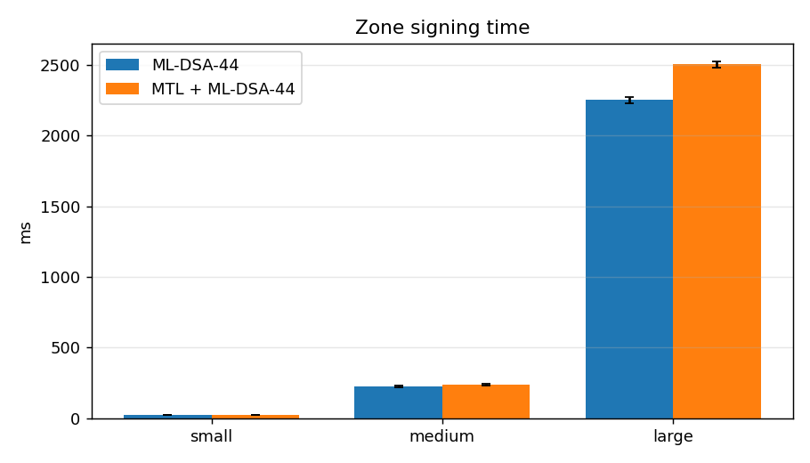
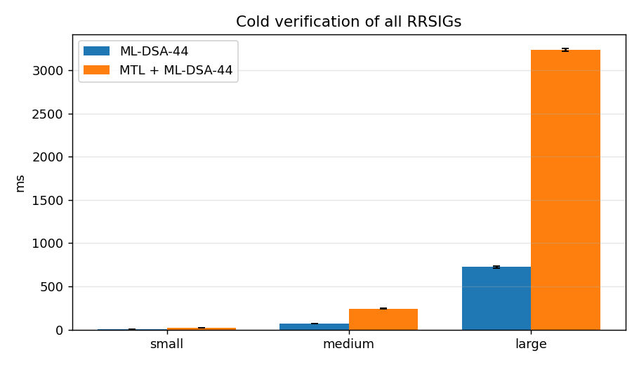
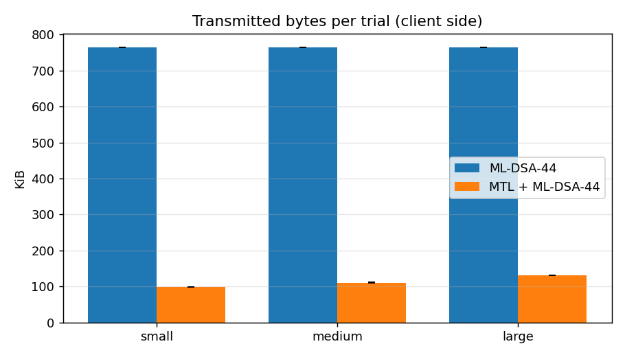

# PS-036 - PQC DNSSEC MTL Benchmark: Results Report

## 1. Pinned benchmark environment

| Item | Value |
|---|---|
| captured_at_utc | 2026-10-25T20:24:48Z |
| host_os | Debian GNU/Linux 12 (bookworm) |
| kernel | 6.17.13+2-amd64 |
| cpu_model | Intel(R) Xeon(R) E-2314 CPU @ 2.80GHz |
| cpu_count | 4 |
| memory_total | 15Gi |
| cpu_governor | n/a |
| turbo_disabled_or_boost | n/a |
| docker | 29.9.2 |
| docker_compose | 5.6.1 |
| cpuset_auth | 0 |
| cpuset_resolver | 1 |
| cpuset_client_and_bench | 2 / 3 |
| powerdns_auth | PowerDNS Authoritative Server 5.0.7 (C) PowerDNS.COM BV |
| powerdns_recursor | PowerDNS Recursor 5.3.10 (C) PowerDNS.COM BV |
| pqc_stack | liboqs 0.16.0 liboqs-python 0.16.0.1 dnspython 2.7.0 pycryptodome 3.23.0 cryptography 46.0.6 |
| images | pqcmtl/ui:latest=ee3ac41abcfb pqcmtl/tools:latest=48c6986b490f pqcmtl/pdns-recursor:rec-53=8807608c5a50 pqcmtl/pdns-auth:auth-50=2aa2ac430bad  |
| testbed_git_commit | n/a |

## 2. Benchmark configuration and workload parameters

| Parameter | Value |
|---|---|
| PQC signature algorithm | ML-DSA-44 (FIPS 204, liboqs), ZSK only |
| MTL instantiation | ML-DSA-44-MTL-SHAKE-128 (draft-harvey-cfrg-mtl-mode-09, n=16, SID=32 B) |
| KSK | ECDSAP256SHA256 (alg 13, classical) |
| Lab DNSSEC algorithm numbers | 200 = ML-DSA-44, 201 = ML-DSA-44-MTL (lab-only) |
| RRSIG encoding (MTL) | MTL-Type octet (0 condensed / 1 full) + MTL signature (draft-fregly-dnsop-slh-dsa-mtl-dnssec) |
| Signed-ladder retrieval | full signature on `_mtlladder.<zone> TXT` (lab stand-in for the mtl-mode-full EDNS option) |
| Batch signing | one ladder signature per zone signing run |
| Denial of existence | NSEC |
| UDP payload | 1232 B (auth truncation threshold and client EDNS size) |
| Dataset sizes (host RRsets in aiori3.test) | {'small': 100, 'medium': 1000, 'large': 10000} |

## 3. Directly measured results

### 3.1 Signing and verification (offline, pinned CPU)

Pinned CPUs: `[3]`. Primitive costs (mean of 500): ML-DSA-44 sign 50.4 µs, verify 20.7 µs; ECDSA P-256 sign 34.9 µs, verify 86.5 µs; MTL cSHAKE128 node hash 8.12 µs.

| Dataset | Mode | RRsets | Zone sign ms (mean±sd) | Cold verify-all ms (mean±sd) | ML-DSA signs | ML-DSA verifies | Mean RRSIG sig bytes | Total RRSIG sig bytes |
|---|---|---|---|---|---|---|---|---|
| small | ML-DSA-44 | 211 | 23.4 ± 1.1 | 7.3 ± 0.2 | 211 | 211 | 2420.0 | 510620 |
| small | MTL + ML-DSA-44 | 213 | 24.5 ± 0.5 | 21.4 ± 1.2 | 1 | 1 | 190.9 | 40653 |
| medium | ML-DSA-44 | 2011 | 224.0 ± 4.0 | 70.4 ± 1.2 | 2011 | 2011 | 2420.0 | 4866620 |
| medium | MTL + ML-DSA-44 | 2013 | 238.2 ± 8.4 | 244.0 ± 1.2 | 1 | 1 | 223.6 | 450101 |
| large | ML-DSA-44 | 20011 | 2251.3 ± 20.8 | 724.4 ± 12.1 | 20011 | 20011 | 2420.0 | 48426620 |
| large | MTL + ML-DSA-44 | 20013 | 2503.6 ± 23.6 | 3235.4 ± 18.7 | 1 | 1 | 290.6 | 5814821 |

> Implementation note: ML-DSA-44 runs in C (liboqs); the MTL node-set / path hashing is driven from Python (cSHAKE128 via pycryptodome, ~one interpreter round-trip per node hash). Per-RRset MTL time is therefore dominated by interpreter overhead, not by the hash itself. The *operation counts* (1 vs N underlying signatures) are implementation-independent.

### 3.2 Live DNS workload (client -> PowerDNS Recursor -> root / test / aiori3.test)

| Dataset | Mode | Queries/trial x trials | Bytes received / trial (mean±sd) | Mean answer bytes | Answer TCP rate | TCP fallbacks / trial | Ladder fetches / trial | p50 latency ms | Crypto ms / trial | Failures |
|---|---|---|---|---|---|---|---|---|---|---|
| large | ML-DSA-44 | 300 x 5 | 765.2 ± 0.0 KiB | 2529 | 1.00 | 305.0 | 0.0 | 1.48 | 10.9 | 0 |
| medium | ML-DSA-44 | 300 x 5 | 765.2 ± 0.0 KiB | 2529 | 1.00 | 305.0 | 0.0 | 1.36 | 10.6 | 0 |
| small | ML-DSA-44 | 300 x 5 | 765.2 ± 0.0 KiB | 2529 | 1.00 | 305.0 | 0.0 | 0.99 | 9.8 | 0 |
| large | MTL + ML-DSA-44 | 300 x 5 | 130.4 ± 0.3 KiB | 399 | 0.00 | 3.0 | 3.0 | 1.16 | 47.9 | 0 |
| large | MTL + ML-DSA-44 (no ladder cache) | 300 x 5 | 1011.0 ± 0.3 KiB | 399 | 0.00 | 3.0 | 302.0 | 1.83 | 60.6 | 0 |
| medium | MTL + ML-DSA-44 | 300 x 5 | 110.7 ± 0.4 KiB | 331 | 0.00 | 3.0 | 3.0 | 1.02 | 35.0 | 0 |
| medium | MTL + ML-DSA-44 (no ladder cache) | 300 x 5 | 1000.4 ± 0.4 KiB | 331 | 0.00 | 3.0 | 302.0 | 1.78 | 49.2 | 0 |
| small | MTL + ML-DSA-44 | 300 x 5 | 98.2 ± 0.3 KiB | 289 | 0.00 | 3.0 | 3.0 | 0.75 | 26.7 | 0 |
| small | MTL + ML-DSA-44 (no ladder cache) | 300 x 5 | 950.3 ± 0.3 KiB | 289 | 0.00 | 3.0 | 302.0 | 1.55 | 40.3 | 0 |

### 3.3 Cache usage - directly measured

Recursor values come from the PowerDNS Recursor statistics API (after a full cache flush at trial start); validator values are the exact serialized sizes of the ladders/keys the validator holds.

| Run | Recursor cache entries (Δ) | Packet-cache entries (Δ) | Recursor RSS Δ (KiB) | Validator ladders | Validator ladder bytes | Validator key bytes |
|---|---|---|---|---|---|---|
| mldsa44_large | 307 | 602 | 141 | 0 | 0 | 4128 |
| mldsa44_medium | 270 | 528 | 303 | 0 | 0 | 4128 |
| mldsa44_small | 107 | 201 | 249 | 0 | 0 | 4128 |
| mtl_large | 310 | 307 | 10 | 3 | 524 | 4128 |
| mtl_large_nocache | 310 | 307 | 8 | 0 | 0 | 4128 |
| mtl_medium | 273 | 270 | 17 | 3 | 556 | 4128 |
| mtl_medium_nocache | 273 | 270 | 20 | 0 | 0 | 4128 |
| mtl_small | 110 | 107 | 130 | 3 | 428 | 4128 |
| mtl_small_nocache | 110 | 107 | 30 | 0 | 0 | 4128 |

> RSS deltas are page-granular and include allocator behaviour; treat them as indicative. Signature-byte cache estimates are in Section 4.2.

## 4. Analytical estimates (kept separate from measurements)

### 4.1 Reference-value endurance and effective signature size (paper Sec. 7.1-7.2)

K_analytic = sqrt(2 ln 2) * sqrt(N0 * rho / alpha);  phi(K,1) = |condensed| + |reference value| / K.
K_measured comes from the real MTL implementation (mtl_rung compatibility checks) over randomised runs.

| N0 | alpha | rho | K measured (median) | K analytic | phi measured B | phi analytic B | ML-DSA-44 B |
|---|---|---|---|---|---|---|---|
| 100 | 10 | 1 | 3.0 | 3.7 | 1025 | 859 | 2420 |
| 100 | 10 | 10 | 6.0 | 11.8 | 599 | 390 | 2420 |
| 100 | 10 | 100 | 8.0 | 37.2 | 492 | 242 | 2420 |
| 100 | 100 | 1 | 1.0 | 1.2 | 2729 | 2344 | 2420 |
| 100 | 100 | 10 | 0.0 | 3.7 | 2729 | 859 | 2420 |
| 100 | 100 | 100 | 1.0 | 11.8 | 2729 | 390 | 2420 |
| 100 | 1000 | 1 | 0.0 | 0.4 | 2729 | 2729 | 2420 |
| 100 | 1000 | 10 | 0.0 | 1.2 | 2729 | 2344 | 2420 |
| 100 | 1000 | 100 | 0.0 | 3.7 | 2729 | 859 | 2420 |
| 1000 | 10 | 1 | 11.0 | 11.8 | 462 | 446 | 2420 |
| 1000 | 10 | 10 | 30.5 | 37.2 | 308 | 292 | 2420 |
| 1000 | 10 | 100 | 70.5 | 117.7 | 259 | 244 | 2420 |
| 1000 | 100 | 1 | 3.0 | 3.7 | 1105 | 933 | 2420 |
| 1000 | 100 | 10 | 6.0 | 11.8 | 663 | 446 | 2420 |
| 1000 | 100 | 100 | 7.0 | 37.2 | 600 | 292 | 2420 |
| 1000 | 1000 | 1 | 1.0 | 1.2 | 2873 | 2473 | 2420 |
| 1000 | 1000 | 10 | 0.0 | 3.7 | 2873 | 933 | 2420 |
| 1000 | 1000 | 100 | 0.0 | 11.8 | 2873 | 446 | 2420 |
| 10000 | 10 | 1 | 36.5 | 37.2 | 357 | 355 | 2420 |
| 10000 | 10 | 10 | 112.5 | 117.7 | 308 | 307 | 2420 |
| 10000 | 10 | 100 | 318.5 | 372.3 | 293 | 292 | 2420 |
| 10000 | 100 | 1 | 10.0 | 11.8 | 547 | 508 | 2420 |
| 10000 | 100 | 10 | 32.0 | 37.2 | 367 | 355 | 2420 |
| 10000 | 100 | 100 | 73.0 | 117.7 | 321 | 307 | 2420 |
| 10000 | 1000 | 1 | 3.0 | 3.7 | 1158 | 989 | 2420 |
| 10000 | 1000 | 10 | 7.0 | 11.8 | 659 | 508 | 2420 |
| 10000 | 1000 | 100 | 6.0 | 37.2 | 722 | 355 | 2420 |

> The approximation assumes N0 >> alpha*rho; rows where alpha*rho approaches N0 are expected to deviate.

### 4.2 Cache footprint of signatures - analytical

Estimated signature bytes a resolver must cache to hold C distinct validated RRsets of the zone (ML-DSA-44: C x 2420; MTL: C x mean condensed size + one signed ladder per zone).

| Dataset | C (distinct RRsets) | ML-DSA-44 bytes | MTL bytes | Reduction |
|---|---|---|---|---|
| small | 100 | 242,000 | 21,706 | 91.0% |
| small | 211 | 510,620 | 42,891 | 91.6% |
| medium | 100 | 242,000 | 25,108 | 89.6% |
| medium | 2011 | 4,866,620 | 452,402 | 90.7% |
| large | 100 | 242,000 | 31,771 | 86.9% |
| large | 20011 | 48,426,620 | 5,816,956 | 88.0% |

## 5. Reproducibility

All numbers in this report are regenerated by `./tb.sh bench-all` (see README). Raw data: `results/crypto/crypto.json`, `results/dns/*/queries.csv`, `results/dns/*/summary.json`, `results/endurance/endurance.json`, `results/env/environment.json`.
